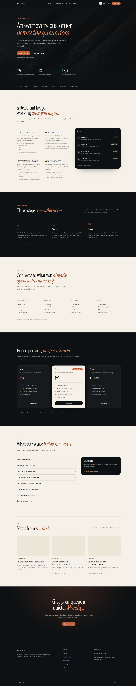

# Umbral

A bilingual landing page for a fictional AI support desk, built with Next.js 16, TypeScript and Tailwind CSS v4.



## What it is

One landing page for an AI customer-support product: hero with proof and metrics, four product capabilities with a mock inbox, a three-step onboarding, a channels grid, three pricing plans, an eight-question FAQ, three notes and a closing call to action. English and Spanish, locale-prefixed routes, browser-language detection and a remembered choice.

This is a front-end demo. There is no backend, no inbox connection, no model call, no auth and no checkout. Pricing is illustrative and the company, customers, plans and articles are fictional.

## Why this over a support-desk template

- **Two locales from one dictionary.** `i18n/dictionaries/en.ts` is the source of truth; `es.ts` is typed against it, so a missing key fails `pnpm typecheck` instead of shipping an empty string.
- **No remote assets.** Photography is generated for this build and served from `public/images`; both fonts are self-hosted files with their OFL licences in `assets/fonts`.
- **No client-side animation library.** Entrances are CSS keyframes and the FAQ uses native `<details>`, so only the locale switcher ships JavaScript.
- **Claims match the code.** The FAQ states there is no backend, the pricing footnote says checkout is not implemented, and the JSON-LD describes only what the page renders.

## Quick start

Requirements: Node 24 and pnpm 11.

```bash
git clone https://github.com/JORDANROBERTO74/umbral.git
cd umbral
pnpm install
pnpm dev
```

Open <http://localhost:3000>.

| Command | What it does |
| --- | --- |
| `pnpm dev` | Start the development server |
| `pnpm build` | Create an optimized production build |
| `pnpm start` | Serve the production build |
| `pnpm lint` | Run ESLint |
| `pnpm typecheck` | Run `tsc --noEmit` |

## Bilingual routing

`proxy.ts` runs before the app: if the first path segment is `en` or `es` it passes through, otherwise it redirects to the stored locale cookie, then to the closest `accept-language` match, then to `en`.

- Copy lives in `i18n/dictionaries/`. `Dictionary` is derived from the English file, so Spanish must mirror every key.
- `app/[locale]/layout.tsx` owns `<html lang>`, fonts, metadata, JSON-LD and the shell.
- `components/locale-switcher.tsx` is the only client component: it writes the cookie and swaps the first URL segment.
- Prices are formatted with `Intl.NumberFormat` from `config/region.ts` (`USD`), not hardcoded in the copy.
- `alternates.languages` in `lib/seo.ts` produces the `hreflang` pair plus `x-default`.

## Project structure

```text
app/
  [locale]/
    layout.tsx           fonts, metadata, JSON-LD, header and footer
    page.tsx             section composition
    not-found.tsx        404 with the visitor's stored locale
    opengraph-image.tsx  1200x630 card rendered with next/og
  globals.css            design tokens and base layer
  icon.svg               brand mark
  robots.ts, sitemap.ts
components/
  sections/              hero, features, how it works, channels, pricing, faq, resources, cta
  site-header.tsx, site-footer.tsx, brand-mark.tsx, locale-switcher.tsx
  ui/link-button.tsx
config/                  site URL and region/currency
i18n/                    locale config, dictionary loader, en + es copy
lib/                     metadata and JSON-LD builders
assets/fonts/            Instrument Serif and Manrope with OFL licences
public/images/           four generated photographs
```

Design tokens live in `app/globals.css`: `ink`, `bone`, `ember`, `ash` and the two hairline alpha values. Components use those utilities, so a palette change is one file.

## Deployment

Built and deployed on Vercel with Node.js 24.x. `NEXT_PUBLIC_SITE_URL` sets the canonical origin used by metadata, `sitemap.xml`, `robots.txt` and the Open Graph card; it falls back to the production URL in `config/site.ts`.

Live demo: <https://umbral.vercel.app>

## Status and scope

Verified with `pnpm typecheck`, `pnpm lint` and `pnpm build`, plus a headless pass over both locales at 390, 768 and 1440 px: locale redirect, `/en`, `/es`, an unknown locale, the 404 route, the mobile layout and the FAQ accordion. No remote asset requests remain.

Out of scope: backend, inbox or knowledge-base connections, assistant replies, auth, payments, analytics beyond Vercel's page-view script, and article detail pages. The notes are cards, not routes.

## License

MIT. See [LICENSE](LICENSE).
